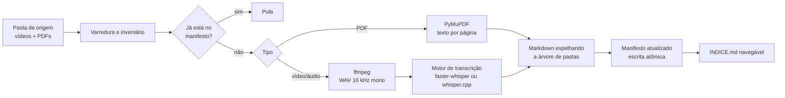

# pos-transcricao

Pipeline local que transforma uma biblioteca de aulas em vídeo e PDFs em uma base de conhecimento em Markdown, pronta para busca, estudo e reaproveitamento.

Foi construído para processar o material da minha pós-graduação em Engenharia e Arquitetura de Dados com IA: **466 arquivos, 42,4 GB, cerca de 53 horas de vídeo**, rodando em um PC Windows com GPU AMD, sem nuvem e sem custo.

## O que ele faz



## Decisões de projeto

| Decisão | Por quê |
| --- | --- |
| Manifesto de checkpoint por arquivo (caminho + tamanho + data de modificação) | Uma rodada de dezenas de horas precisa poder parar e retomar. Reexecutar é idempotente: o que já foi feito não é refeito. |
| Escrita atômica do manifesto (`.tmp` + `os.replace`) | Um Ctrl+C no meio da gravação não corrompe o controle. |
| Motores de transcrição plugáveis | `faster-whisper` cobre CPU e NVIDIA; `whisper.cpp` com Vulkan cobre GPUs AMD e Intel, que o CTranslate2 não suporta no Windows. |
| Extração do áudio para WAV 16 kHz mono antes de transcrever | É o formato que os dois motores esperam, e reduz muito o volume lido do disco. |
| Saída em Markdown com marcas de tempo a cada ~45 s | Legível por humanos, fácil de indexar e de citar o trecho exato da aula. |
| Falha em um arquivo não derruba a rodada | O erro é registrado e o pipeline segue; o arquivo volta na próxima execução. |

## Instalação

```bash
pip install pymupdf               # PDFs
pip install faster-whisper        # motor de CPU / NVIDIA
winget install Gyan.FFmpeg        # ffmpeg no Windows
```

### GPU AMD ou Intel no Windows (motor `whispercpp`)

1. Baixe um build do [whisper.cpp](https://github.com/ggml-org/whisper.cpp) compilado com Vulkan para Windows x64 e extraia em `C:\whisper`. O projeto oficial ainda distribui só builds de CPU e CUDA; existem builds de terceiros, ou você pode compilar o oficial com Visual Studio Build Tools, Vulkan SDK e `cmake -DGGML_VULKAN=1`.
2. Baixe o modelo [`ggml-large-v3-turbo-q5_0.bin`](https://huggingface.co/ggerganov/whisper.cpp/resolve/main/ggml-large-v3-turbo-q5_0.bin) (574 MB) para a mesma pasta.
3. Confirme que o driver da placa (AMD Adrenalin) está atualizado e rode `C:\whisper\whisper-cli.exe --help`.

#### Compilando o whisper.cpp oficial com Vulkan (caminho testado numa GPU AMD)

```powershell
winget install Kitware.CMake
winget install KhronosGroup.VulkanSDK
winget install Microsoft.VisualStudio.2022.BuildTools --override "--wait --passive --add Microsoft.VisualStudio.Workload.VCTools --includeRecommended"
# feche e abra o PowerShell; $env:VULKAN_SDK deve apontar para o SDK

git clone https://github.com/ggml-org/whisper.cpp C:\whisper-src
cd C:\whisper-src
cmake -B build -DGGML_VULKAN=1
cmake --build build --config Release -j
Test-Path build\bin\Release\ggml-vulkan.dll   # precisa dar True
Copy-Item build\bin\Release\* C:\whisper\ -Force

# teste: o log deve mostrar "ggml_vulkan: Found 1 Vulkan devices"
C:\whisper\whisper-cli.exe -m C:\whisper\ggml-large-v3-turbo-q5_0.bin -f C:\whisper-src\samples\jfk.wav -l en
```

Armadilhas encontradas:

- **Pasta `build` copiada de outro lugar:** o CMake reaproveita o `CMakeCache.txt` antigo, compila no diretório original e ignora o `-DGGML_VULKAN=1`. Apague a pasta `build` antes de configurar.
- **Compilou, mas sem GPU:** se não existir `ggml-vulkan.dll` na saída, o build é só de CPU, mesmo com o `--help` funcionando.
- **Não compile dentro de `C:\Windows\System32`:** exige administrador e espalha arquivos numa pasta do sistema.

## Uso

```powershell
# 1. Inventário: quanto conteúdo existe e quanto tempo deve levar
python transcrever_pos.py --origem "G:\XP" --destino "G:\XP\TRANSCRICAO" --inventario

# 2. PDFs (minutos)
python transcrever_pos.py --origem "G:\XP" --destino "G:\XP\TRANSCRICAO" --apenas pdf

# 3. Piloto de 3 vídeos na GPU AMD
python transcrever_pos.py --origem "G:\XP" --destino "G:\XP\TRANSCRICAO" --limite 3 `
    --motor whispercpp --whisper-cli "C:\whisper\whisper-cli.exe" `
    --modelo-ggml "C:\whisper\ggml-large-v3-turbo-q5_0.bin"

# 4. Rodada completa: o mesmo comando sem --limite
```

No primeiro vídeo o log deve mostrar `GPU via Vulkan detectada pelo whisper.cpp`. Se aparecer o aviso de que não viu Vulkan, o `whisper-cli` está rodando só na CPU.

## Testes

Os testes rodam o pipeline de ponta a ponta (ffmpeg, PyMuPDF, manifesto, índice) com dublês no lugar dos motores, sem baixar modelos:

```bash
pip install pytest pymupdf
pytest -q
```

## Direitos autorais do conteúdo

Este repositório contém só o código. O material das aulas e as transcrições geradas pertencem à instituição de ensino e ficam fora do controle de versão (veja `.gitignore`). Não publique transcrições de cursos pagos.

## Licença

MIT
